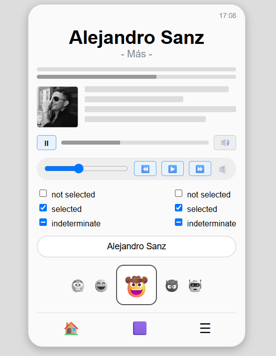

# Reproductor en React

Práctica de Desarrollo de interfaces: réplica en React de un mockup de reproductor musical con el disco *Más* de Alejandro Sanz.



## Cómo ejecutar el proyecto

```bash
git clone https://github.com/Gonzalo-Lazaro/reproductor-en-react.git
cd reproductor-en-react
npm install
npm run dev
```

Después abre `http://localhost:5173/`.

## Proceso de creación

1. Creé el proyecto con Vite: `npm create vite@latest reproductor-en-react` (React + JavaScript).
2. Limpié los estilos de ejemplo de la plantilla.
3. Dividí el diseño en 9 componentes dentro de `src/components/`.
4. Pasé los textos e imágenes a props con valores por defecto (Alejandro Sanz).
5. Reuní los datos de cada cantante en `src/data/cantantes.js`.
6. Añadí los estilos en `src/App.css` comparando con el mockup.
7. Subí el proyecto a GitHub haciendo commits por cada componente.

## Estructura de componentes

```
App
├── Encabezado          (artista, álbum y hora)
├── BarraProgreso       (dos barras decorativas)
├── PanelLateral        (foto + bloques de texto simulado)
├── MiniReproductor     (pausa, barra de progreso y volumen)
├── Controles           (slider de volumen, retroceso, play y avance)
├── Casillas            (desmarcada, marcada e indeterminada, en 2 columnas)
├── BarraBusqueda       (buscador con el nombre del artista)
├── Carrusel            (emojis con el central destacado)
└── BarraNavegacion     (tres iconos inferiores)
```

## Props de los componentes

| Componente | Props (valor por defecto) |
|---|---|
| Encabezado | `artista` ("Alejandro Sanz"), `album` ("Más"), `hora` ("17:08") |
| BarraProgreso | `porcentaje` (60) |
| PanelLateral | `imagen` ("/img/alejandro-sanz.png"), `alt` ("Alejandro Sanz") |
| MiniReproductor | `porcentaje` (40) |
| Controles | `volumen` (40) |
| BarraBusqueda | `texto` ("Alejandro Sanz") |
| Carrusel | `emojis` (lista de 5), `centro` (2) |
| BarraNavegacion | `iconos` (["🏠", "🟪", "☰"]) |

## Cómo cambiar de cantante

Los datos de cada cantante están en `src/data/cantantes.js` (Alejandro Sanz y David Bisbal), con sus fotos en `public/img/`.

Para cambiar de cantante solo hay que editar **una línea** de `src/App.jsx`, sin tocar ningún componente:

```jsx
const cantante = cantantes.bisbal; // o cantantes.sanz
```

Para añadir otro cantante: añade su foto a `public/img/` y un nuevo objeto en `cantantes.js`.
